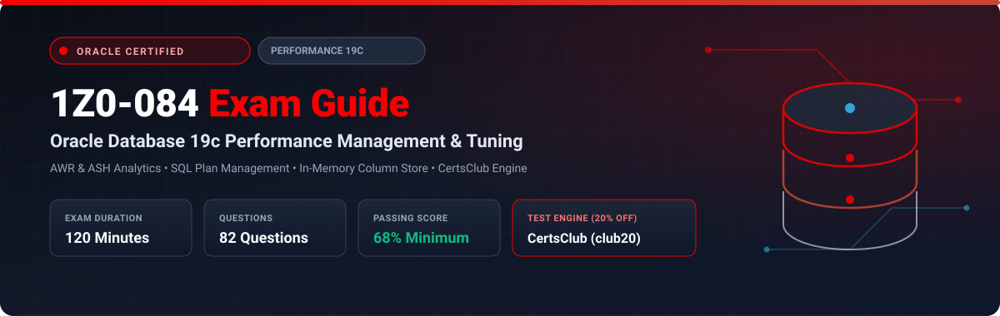

<p align="center">
  
</p>

# Oracle Database 19c: Performance Management and Tuning (1Z0-084) Exam Study Guide & Practice Test Resource Portal

[-f80000?style=for-the-badge&logo=oracle&logoColor=white)](https://education.oracle.com/)
[](https://education.oracle.com/)
[](https://education.oracle.com/)
[](https://education.oracle.com/)
[](https://education.oracle.com/)
[-28a745?style=for-the-badge&logo=shield)](https://www.certsclub.com/oracle/)

---

## 1. Exam Overview & Candidate Profile

The **Oracle Database 19c: Performance Management and Tuning (1Z0-084)** exam tests advanced expertise in diagnosing, analyzing, and eliminating performance bottlenecks across Oracle database instances and SQL statements. The certification proves your proficiency in leveraging Automatic Workload Repository (AWR), Automatic Database Diagnostic Monitor (ADDM), Active Session History (ASH), SQL Plan Management (SPM), In-Memory Column Store (IMCS), Database Resource Manager, and Operating System / I/O calibration tools.

Passing 1Z0-084 awards the **Oracle Certified Specialist, Oracle Database 19c: Performance Management and Tuning Administrator** credential.

### Target Candidate Profile & Career Roles
* **Senior Performance Tuning Database Administrators**
* **Database Optimization & Capacity Planning Engineers**
* **Mission-Critical Application Architects & Database Benchmarking Specialists**
* **Prerequisites:** In-depth knowledge of Oracle Database 19c architecture, execution plans, SQL trace/TKPROF analysis, and memory management.

---

## 2. Key Exam Specifications

| Parameter | Official Specification |
| :--- | :--- |
| **Exam Code** | 1Z0-084 |
| **Exam Title** | Oracle Database 19c: Performance Management and Tuning |
| **Associated Credential** | Oracle Certified Specialist, Oracle Database 19c: Performance Management and Tuning Administrator |
| **Duration** | 120 Minutes |
| **Number of Questions** | 82 Questions |
| **Passing Score** | 68% |
| **Question Format** | Multiple Choice (Single and Multiple Select) |
| **Delivery Vendor** | Pearson VUE / Oracle University Online Remote Proctoring |
| **Recommended Practice Test Engine** | **[1Z0-084 Practice Test - CertsClub](https://www.certsclub.com/oracle/)** (Coupon: `club20` for 20% off) |

---

## 3. Official Blueprint & Exam Domain Breakdown

| Domain Code | Domain Title | Weighting | Key Competencies Covered |
| :--- | :--- | :---: | :--- |
| **1.0** | **Tuning Methodology & Diagnostic Tools** | **20%** | Systematic tuning methodologies; Interpreting AWR reports, AWR Compare Periods, ADDM recommendations, and ASH analytics; Real-Time Database Operation Monitoring. |
| **2.0** | **Instance & Memory Tuning** | **20%** | Sizing Buffer Cache, Shared Pool, Large Pool; Automatic Shared Memory Management (ASMM) vs Automatic Memory Management (AMM); In-Memory Column Store (IMCS) architecture and compression tiers; Result Cache configuration. |
| **3.0** | **SQL Statement Tuning & Optimization** | **25%** | Cost-Based Optimizer (CBO) mechanics, object statistics and histogram types (Frequency, Top-Frequency, Hybrid); Adaptive Execution Plans; SQL Plan Management (SPM baselines, capture, and evolution); SQL Tuning Advisor. |
| **4.0** | **Managing Wait Events & Latches** | **18%** | Diagnosing wait events (`db file sequential read`, `db file scattered read`, `log file sync`, `enq: TX - row lock contention`, `buffer busy waits`); Mutexes and Latches; Reducing latch contention. |
| **5.0** | **Database Resource Manager** | **17%** | Creating Resource Plans, Plan Directives, and Consumer Groups; Managing multi-tenant CDB and PDB resource allocation shares; Limiting runaway queries (`SWITCH_TIME`). |

---

## 4. Deep Dive into Complex Exam Topics

### 4.1 SQL Plan Management (SPM) Evolution Cycle
SPM prevents plan regressions by establishing known good execution baselines:
1. **Plan Capture:** Plans are captured into the SQL Management Base (SMB) automatically or manually. The first plan is set to `ENABLED=YES` and `ACCEPTED=YES`.
2. **New Plan Detection:** When the optimizer finds a new plan, it is stored as `ENABLED=YES` but `ACCEPTED=NO`.
3. **Plan Evolution:** The new plan is tested by the SPM Evolution Advisor (`DBMS_SPM.EVOLVE_SQL_PLAN_BASELINE`). If performance is strictly better than the accepted plan, it is transitioned to `ACCEPTED=YES`.

### 4.2 Interpreting Top Wait Events in AWR
* **`db file sequential read`:** Single block physical read from disk into buffer cache (typically index lookups or table lookups by ROWID). High percentages indicate poor indexing or missing covered indexes.
* **`db file scattered read`:** Multi-block physical read (typically full table scans or fast full index scans). Normal for reporting batch queries, alarming for OLTP workloads.
* **`log file sync`:** Waiting for LGWR to flush redo buffer to online redo logs upon COMMIT. Caused by high commit frequency in tight loops, slow disk I/O, or undersized redo log buffers.

---

## 5. Scenario-Based Demo Questions & Technical Explanations

### Question 1: SQL Plan Baseline Behavior
**Scenario:** A critical query running in your production database has an accepted SQL plan baseline. During maintenance, a DBA creates a new composite index designed to optimize this query. The CBO calculates that using this new index produces a lower cost than the current accepted plan.

What does the Cost-Based Optimizer do when the application executes this query next?

A) The CBO immediately uses the new index execution plan because its cost is lower.  
B) The CBO ignores the new index and continues using the accepted SQL plan baseline until the new plan is evolved and accepted.  
C) The CBO raises `ORA-02097: parameter cannot be modified`.  
D) The CBO purges the baseline and marks the statement as invalid.  

**Correct Answer:** **B**

**Detailed Explanation:**
* Under SQL Plan Management (SPM), the CBO evaluates the new index and adds the new plan to the SQL Management Base (SMB) as an **unaccepted plan** (`ACCEPTED=NO`).
* To guarantee plan stability and prevent performance regression, the database continues executing the query using the existing **accepted baseline plan**.
* The new plan will only be utilized after it has been verified to perform faster via `DBMS_SPM.EVOLVE_SQL_PLAN_BASELINE` and marked `ACCEPTED=YES`.

---

## 6. Recommended Preparation Strategy & Practice Testing Engine

To pass 1Z0-084:

1. **Analyze Real AWR and ASH Reports:** Generate reports during benchmark load tests and trace SQL using `DBMS_MONITOR` and `TKPROF`.
2. **Master SPM and In-Memory Directives:** Practice configuring In-Memory Column Store population and SQL Plan Baselines.
3. **Practice Full-Length Mock Exams:** Use **[CertsClub Oracle 1Z0-084 Practice Tests](https://www.certsclub.com/oracle/)**.
   * Tests wait-event diagnosis, CBO histograms, and AWR metrics under timed conditions.
   * Access verified technical explanations for all scenario questions.
   * Enter discount coupon **`club20`** at checkout on [CertsClub](https://www.certsclub.com/oracle/) for 20% off.

---

## 7. Official Documentation & References

* [Oracle Database Database Performance Tuning Guide 19c](https://docs.oracle.com/en/database/oracle/oracle-database/19/tgdba/)
* [Oracle University 1Z0-084 Exam Page](https://education.oracle.com/)
* [CertsClub 1Z0-084 Practice Engine](https://www.certsclub.com/oracle/)

---

## 8. SEO & Discovery Keywords
```
1z0-084, 1z0-084 dumps, 1z0-084 exam questions, oracle performance tuning 19c exam,
1z0-084 practice test, certsclub 1z0-084, awr report tuning, sql plan management,
in memory column store, wait event db file sequential read, addm diagnostics
```
